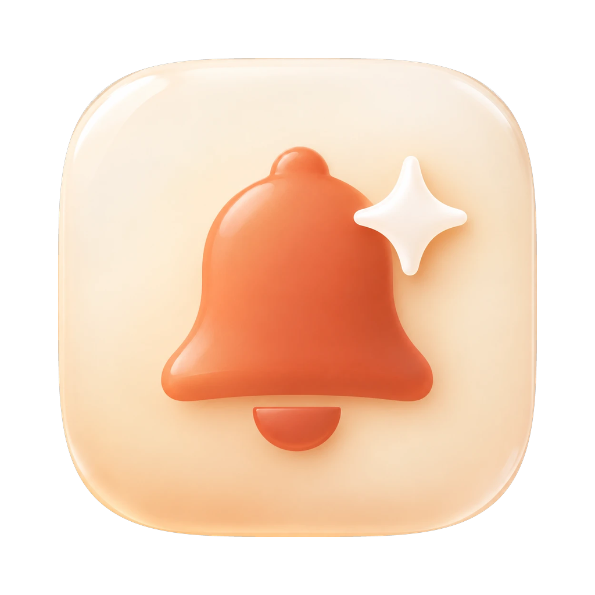

# claude-code-notify



macOS notifications for [Claude Code](https://docs.claude.com/en/docs/claude-code) with a proper icon, instead of the Script Editor scroll you get from `osascript`.

You get a banner when Claude finishes a task or needs your attention. Each banner shows the project name and Claude's own message, for example "Claude needs your permission to use Bash".

## Why a tiny app?

macOS always takes a notification's icon from the app that posts it. `osascript -e 'display notification ...'` posts as Script Editor. `terminal-notifier` 3.x dropped `-appIcon` and `-sender`. So this repo builds a small background app, `ClaudeNotify.app`, that carries its own icon and posts the notifications.

## Install

Requires macOS. No other dependencies.

```bash
git clone https://github.com/kawsarwn/claude-code-notify.git
cd claude-code-notify
./install.sh
```

This builds `~/.claude/ClaudeNotify.app`, copies the hook script to `~/.claude/hooks/claude-notify.sh`, and sends a test notification. Allow notifications for ClaudeNotify if macOS asks.

Then add the hooks to `~/.claude/settings.json`:

```json
{
  "hooks": {
    "Notification": [
      { "hooks": [{ "type": "command", "command": "~/.claude/hooks/claude-notify.sh" }] }
    ],
    "Stop": [
      { "hooks": [{ "type": "command", "command": "~/.claude/hooks/claude-notify.sh" }] }
    ]
  }
}
```

If you already have a `hooks` section, add the `Notification` and `Stop` entries to it.

### Using the Claude desktop app?

The desktop app sends its own banners too, so you'd get two of each. Turn the app's off in Settings → Claude Code: set "Task complete notifications" to Off and "Permission request" / "Question" notifications to Badge.

## Use your own icon

1. Make a 1024×1024 PNG and turn it into `assets/ClaudeNotify.icns` (for example with [Image2icon](https://img2icnsapp.com), or `iconutil`).
2. Change `BUNDLE_ID` in `install.sh` to something new. macOS caches notification icons per app ID, so a new icon needs a new ID.
3. Run `./install.sh` again.

## How it works

1. Claude Code runs `claude-notify.sh` and passes the hook's JSON on stdin.
2. The script reads the event, project folder and message with `plutil` (built into macOS), writes them to a temp file, and opens `ClaudeNotify.app` with that file.
3. The app reads the file, deletes it, and posts the notification. Each notification gets its own file, so two alerts at once don't mix up their messages.

## Troubleshooting

- **No banner:** check System Settings → Notifications → ClaudeNotify is allowed. Focus modes can also hide banners.
- **Wrong or blank icon:** macOS caches icons. Log out and back in, or change `BUNDLE_ID` and reinstall.
- **Test the hook by hand:**
  ```bash
  echo '{"hook_event_name":"Stop","cwd":"'"$PWD"'"}' | ~/.claude/hooks/claude-notify.sh
  ```

## Uninstall

```bash
./uninstall.sh
```

Then remove the two hooks from `~/.claude/settings.json`.

## Development

```bash
./test.sh
```

Checks the hook's parsing on sample events and that the AppleScript compiles. It sends no notifications.

---

Not affiliated with Anthropic. MIT licensed.
